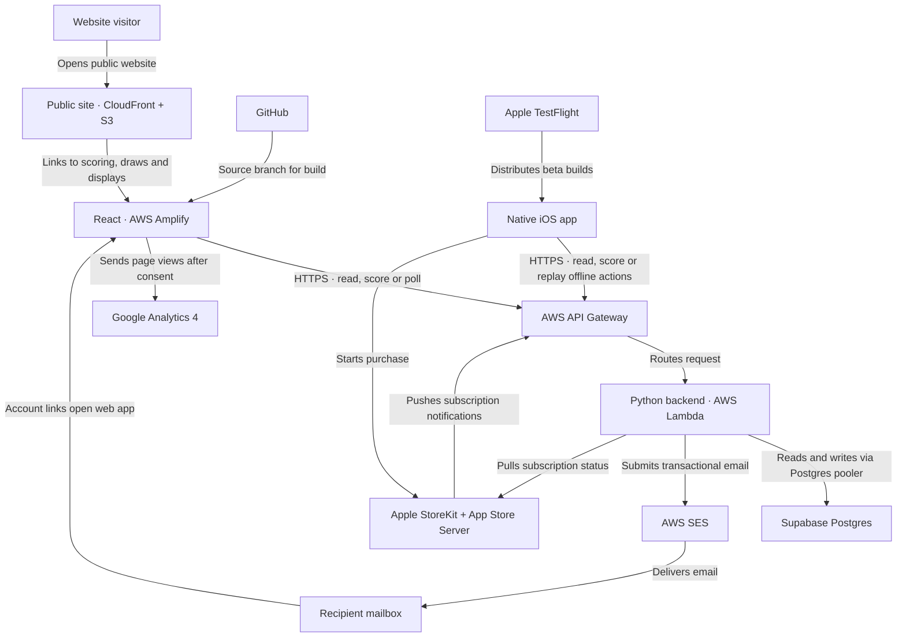
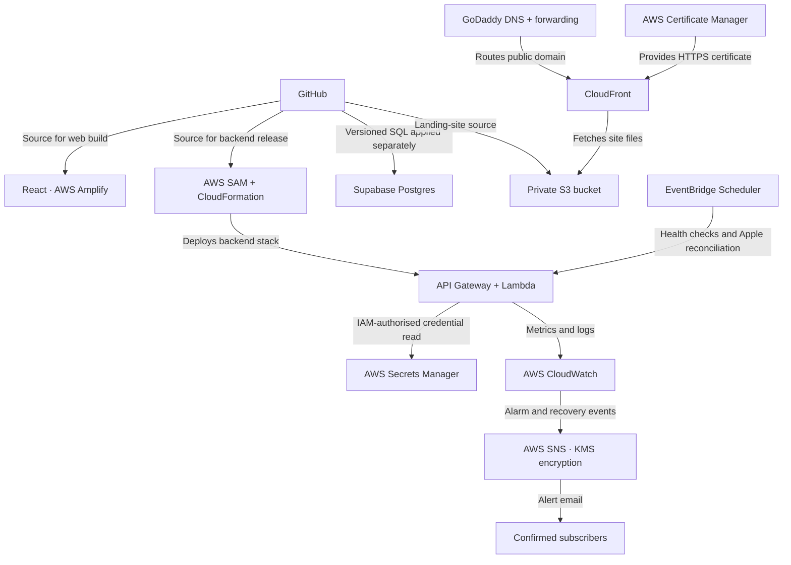

# HitnScore Backup And Recovery Runbook

**Naming:** HitnScore is the customer-facing application. `RcktScore` is the internal project and repository code name.

Last reviewed against the repository: 6 November 2026

## Purpose

This runbook defines how to protect, rebuild, and recover the services used to
create and run HitnScore. It combines the service relationships, data flow,
deployment model, backup requirements, and detailed recovery procedures in one
operational document.

The repository and its infrastructure templates were inspected for this
runbook. Live settings in GitHub, AWS, Supabase, GoDaddy, Apple, and Google were
not inspected. A control marked **verify** or **proposed** is not confirmed until
an owner records evidence from the relevant provider.

## Recovery Principles

1. Protect people and preserve evidence before changing a live system.
2. Stop or limit writes when continued use could increase data loss.
3. Prefer an application rollback for a bad release. Restore the database only
   for material corruption or destructive data loss.
4. Restore into an isolated replacement environment first whenever possible.
5. Treat Supabase Postgres as the authoritative application-data store.
6. Treat GitHub, the lead developer's backed-up local repository, and immutable
   release references as the recovery sources for application code, migrations,
   infrastructure templates, and static content.
7. Never store database passwords, signing keys, API private keys, session
   tokens, or unredacted backup files in Git, tickets, chat, or release notes.
8. Do not edit or reverse an accepted migration. Correct schema defects with a
   new forward migration, following [promotion-runbook.md](promotion-runbook.md).
9. Record every recovery decision, command, provider change, validation result,
   and approver in an incident log.

## Service Relationships And Recovery Order

### Application Data Flow



React runs in the browser after Amplify serves the app bundle. Web and iOS use
the same API and authoritative database. Spectator views and court displays
poll the API; court displays use a five-second default polling interval. The
iOS app can queue actions for one previously loaded active match while offline
and replay them after reconnecting.

### Hosting, Deployment, And Monitoring



Recover dependencies in this order unless the incident affects only one
isolated service:

1. secure administrator access, incident evidence, Git commit/tag, and secrets
2. Supabase Postgres and its verified schema-migration ledger
3. AWS Secrets Manager, IAM, API Gateway, Lambda, schedules, and alarms
4. Amplify web application
5. public S3/CloudFront site, ACM certificate, and GoDaddy DNS/forwarding
6. SES email identities and delivery
7. Apple purchase notifications, reconciliation, iOS build, and TestFlight
8. displays, analytics, and other non-authoritative integrations

### Current Recovery Boundaries

- HTTP polling is the live score-distribution path. WebSocket infrastructure is
  scaffolded but is not required to restore current scoring or display service.
- Apple Push Notification service delivery is not implemented. The persisted
  in-app notification inbox recovers with Postgres.
- Stripe checkout is not implemented and is not a recovery dependency.
- Android/Compose is a foundation rather than a released product client.
- Identity-level profile images are held in the retained, encrypted private
  `ProfileImagesBucket`; Postgres stores their current object key and version.
  Device Keychain sessions, local timers, and unsynchronised offline actions
  are not contained in server backups.
- Google Analytics is telemetry, not a source from which application records
  may be reconstructed.

## Incident Classification

| Severity | Example | Initial response target | Authority |
| --- | --- | --- | --- |
| SEV-1 | Authoritative data corruption, confirmed breach, database unavailable, or scoring writes unsafe | Begin immediately; freeze risky writes | Incident lead and data owner approve recovery point and reopening |
| SEV-2 | API/web/iOS service materially unavailable with data believed intact | Begin within 30 minutes | Incident lead approves artifact rollback or service rebuild |
| SEV-3 | One integration degraded, such as email, analytics, or a display path | Begin within 4 business hours | Service owner coordinates isolated recovery |
| SEV-4 | Documentation, test, or non-production recovery defect | Schedule and track | Product/engineering owner |

The targets above are proposed until the operational owners approve an on-call
model. A security incident may require legal/privacy escalation and credential
rotation in addition to the technical recovery steps in this document.

## Service Inventory And Backup Authority

| Service or product | Role | Authoritative recovery source | Required protection |
| --- | --- | --- | --- |
| GitHub repository | Code, SQL migrations, infrastructure templates, static site, tests, and documentation | Protected remote repository plus the lead developer's backed-up local repository | Branch protection, MFA, release tags, confirmation that the local backup includes the complete `.git` directory, and access-owner record |
| Supabase Postgres | Identities, sessions, clubs, courts, matches, events, notifications, subscriptions, and audit records | Supabase managed daily backup plus encrypted logical exports | Confirm plan, retention, region, latest daily backup, restore procedure, and restore test; PITR is deliberately deferred |
| AWS SAM/CloudFormation | API Gateway, Lambda, EventBridge schedules, SNS, CloudWatch alarms, and IAM wiring | `backend/template.yaml`, release commit, parameters, and deployment evidence | Export non-secret parameters and stack outputs; retain deploy role and region details |
| AWS Amplify Hosting | React/Vite application at `app.hitnscore.com` | Git release commit and `amplify.yml` | Record app ID, region, branch, domain, build variables, redirects, and access settings |
| S3 and CloudFront | Public landing site at `www.hitnscore.com` | `weblanding/`, `infrastructure/weblanding-cloudfront.yaml`, and deployment scripts | Git-only content recovery is accepted; S3 versioning is not required; retain stack outputs, domain, and certificate mapping |
| GoDaddy | DNS and root-domain forwarding | Exported DNS/forwarding inventory and registrar account recovery | MFA, account recovery, domain auto-renewal, recovery codes, and periodic DNS export |
| AWS Certificate Manager | CloudFront TLS certificate | DNS-validated certificate can be reissued | Record certificate ARN/domain/region and preserve validation CNAMEs in DNS |
| AWS SES | Transactional account, reset, invitation, enquiry, and feedback email | Verified identity configuration, DNS records, and repository templates | Export identity/domain records, sending region, suppression handling, and quota state |
| AWS Secrets Manager | Apple server API signing material and future runtime secrets | Current secret plus separately escrowed original key material | Enable recovery window/rotation policy; escrow encrypted key and metadata with restricted access |
| CloudWatch, SNS, and KMS | Logs, health metrics, alarms, and alert delivery | CloudFormation for alarms/topic; provider logs for evidence | The 67 current HitnScore Lambda log groups were verified at 90-day retention on 6 November 2026; protect future groups, verify subscribers, and test alerts |
| Apple Developer and App Store Connect | iOS signing, TestFlight, StoreKit products, purchases, notifications, and subscription lifecycle | Glenn Rowe's Apple account plus encrypted recovery copies of irreplaceable private keys and a configuration inventory | Glenn Rowe is the sole authorised owner; retain MFA/account recovery, signing inventory, key recovery, product/URL screenshots, and agreements |
| Native iOS app | Scoring client and one-match offline action queue | Git source, Xcode project, App Store Connect build history, and local unsynchronised device queue | Preserve signing access and release configuration; never erase a device with queued scores during an outage |
| Native Android foundation | Future Android client; product flows are not yet released | Git source and Gradle project | No production application data currently requires recovery; protect future keystore before release |
| Google Analytics 4 | Consented, sanitised web usage analytics | Google property; not an application-data source | Record property/stream IDs, administrators, retention settings, and consent configuration |
| Court displays and ESP source | Public display sessions and optional display firmware | Display/session data in Postgres; firmware source in Git | Escrow device Wi-Fi/API provisioning outside Git and keep a known-good firmware build procedure |

## Approved Recovery Objectives

These are the current operating targets, not guarantees from the providers.
Measure the achieved values during each exercise and review them as HitnScore's
user base and revenue grow.

| Capability | Proposed RPO | Proposed RTO | Reason |
| --- | --- | --- | --- |
| Supabase application data | Up to 24 hours under the accepted daily-backup policy | 4 hours | PITR is deliberately deferred until user-base and revenue growth justify it |
| API and backend | No data loss beyond the database RPO | 2 hours after database availability | Infrastructure is reproducible from SAM/CloudFormation and Git |
| React web app | No application-data loss | 2 hours | Rebuild and deploy a known-good Git revision through Amplify |
| Public landing site | 24 hours | 4 hours | Static source is retained in Git and can be redeployed to replacement hosting |
| Transactional email | No database loss; delayed messages may need reissue | 4 hours | Account flows can resume after SES identities and DNS are restored |
| Apple subscription processing | No verified entitlement loss; notifications can be reconciled | 8 hours | Postgres audit plus Apple Server API reconciliation provides repair evidence |
| iOS distribution | No server-data loss | 1 business day for an existing build; longer if Apple review is required | Existing TestFlight/App Store builds remain usable if the backend contract is compatible |
| Analytics | Up to provider retention limits | 2 business days | Analytics is useful but does not block scoring |

## Approved Backup Decisions

| Area | Decision | Review trigger |
| --- | --- | --- |
| Source code | GitHub plus the lead developer's device backup; no separate weekly Git bundle | Device-backup method or repository ownership changes |
| Public landing-site content | Local `weblanding/` folder and Git history are authoritative; S3 versioning remains disabled | Instant object-level rollback becomes operationally valuable |
| Supabase | Recover from the latest clean daily managed backup and accept an RPO of up to 24 hours; do not enable PITR now | User-base, scoring volume, or revenue growth makes a day's potential loss unacceptable |
| CloudWatch | Retain Lambda logs for 90 days | Security, legal, support, or cost requirements change |
| Apple signing | Glenn Rowe is the sole authorised signing and App Store Connect owner | The business adds an authorised developer or operations owner |

## Backup Schedule

| Frequency | Action | Evidence to retain |
| --- | --- | --- |
| Every release | Tag or record the exact Git commit; verify migration checksums; export migration ledger; record backend/frontend deployment IDs and compatible iOS build | Release record stored without secrets |
| Daily | Confirm Supabase managed backup completion and CloudWatch/SNS health | Automated status or dated operator check |
| Weekly | Create an encrypted logical database export; verify Git remote health; export changed provider configuration | Backup checksum, size, date, environment, and encrypted storage location |
| Monthly | Verify domain renewal, MFA/recovery access, certificate expiry, SES identities, Secrets Manager metadata, Apple agreements/keys, and alert subscribers | Signed checklist and screenshots with secrets redacted |
| Quarterly | Restore database into an isolated environment and rebuild backend/web from a release commit | Timed exercise report, validation results, defects, and follow-up owners |
| Annually | Full service-recovery exercise including DNS, email, Apple lifecycle reconciliation, and administrator succession | Approved disaster-recovery report |

Backups must use encrypted storage separate from the primary service account.
HitnScore currently has one authorised operator, Glenn Rowe. Account recovery,
credential-vault access, and device backup must therefore be tested without
assuming that a second operator is available.

## 1. GitHub And Local Repository Backup And Recovery

### Backup

1. Require MFA for the repository administrator. Glenn Rowe is the current sole
   owner; retain tested account-recovery access.
2. Protect the production branch and require reviewed changes for releases.
3. Create an annotated release tag for every promoted backend/web/iOS-compatible
   revision.
4. Retain the lead developer's local repository through the existing device
   backup. Confirm that this protects the complete repository, including the
   hidden `.git` directory, branches, and tags, rather than only visible source
   files.
5. Periodically validate the backed-up local repository:

   ```bash
   git fsck --full
   git branch --all
   git tag --list
   git log -5 --oneline --decorate
   ```

6. Confirm that the device backup is encrypted and can restore the repository
   to another machine. A same-device duplicate that is not included in a device
   backup does not protect against device loss or disk failure.
7. Separately inventory GitHub settings that are not in Git: collaborators,
   branch protection, Actions variables/secrets, deploy keys, webhooks, and
   environment approvals. Store names and purpose, never secret values.

### Recovery

1. Restore the local repository from the lead developer's device backup to a
   trusted machine.
2. Verify the restored Git database, then clone it into an isolated directory:

   ```bash
   git -C /path/to/restored/RcktScore fsck --full
   git clone /path/to/restored/RcktScore RcktScore-recovered
   cd RcktScore-recovered
   git fsck --full
   git log -5 --oneline --decorate
   ```

3. Create or secure the replacement remote, then push branches and tags only
   after the incident owner approves the verified history.
4. Recreate branch protection, administrators, deployment integrations, and
   environment controls from the configuration inventory.
5. Verify migration integrity before any deployment:

   ```bash
   python3 scripts/check_migrations.py verify
   ```

## 2. Supabase Postgres Backup

The current documentation records one pre-launch Supabase environment with
daily backups. The approved policy is to recover from the latest clean daily
backup and accept up to 24 hours of data loss. Point-in-Time Recovery is not
being enabled at the current user-base and revenue level. Reconsider PITR when
increased scoring volume makes that potential loss unacceptable.

### Managed Backup Check

1. Sign in to Supabase using an administrator account protected by MFA.
2. Select the correct project and confirm its project reference, region, plan,
   database version, daily backup schedule, and retention.
3. Confirm the latest completed daily backup is no more than 24 hours old.
4. Record the timestamp and provider status in the daily operations evidence.
5. Before a release containing migrations, record the exact recovery point in
   the release record.

### Encrypted Logical Export

Use a direct database connection intended for administration rather than an
application connection pooler when the provider permits it. Use a compatible
`pg_dump` client and a credential supplied through a secure prompt or temporary
environment, not shell history.

```bash
pg_dump \
  --format=custom \
  --no-owner \
  --no-acl \
  --file=hitnscore-ENV-YYYY-MM-DD.dump \
  "$SUPABASE_DIRECT_DB_URL"

pg_restore --list hitnscore-ENV-YYYY-MM-DD.dump > hitnscore-ENV-YYYY-MM-DD.contents.txt
shasum -a 256 hitnscore-ENV-YYYY-MM-DD.dump
```

1. Encrypt the dump before it leaves the trusted machine.
2. Store the encrypted dump, checksum, contents list, database version,
   environment, Git commit, and migration-ledger export together.
3. Restrict access because the dump contains personal data, password hashes,
   sessions, match history, and subscription records.
4. Apply the approved retention and secure-deletion policy. Never use a live
   production dump as an unrestricted developer fixture.

Export the migration ledger with the read-only query in
`scripts/migration-ledger-status.sql` and compare it with
`backend/schema/checksums.sha256` from the release commit.

## 3. Supabase Restore And Validation

### Decide Whether A Restore Is Necessary

Do not restore for a frontend or Lambda defect. Roll back the application
artifact instead. Restore only when the incident owner confirms corruption or
destructive data loss and approves the expected loss of valid writes after the
selected recovery point.

### Restore To An Isolated Project First

1. Declare a write freeze or maintenance state for affected flows. Preserve
   logs and record the last known-good and first known-bad timestamps.
2. Identify the newest clean managed recovery point or logical backup.
3. Estimate valid records created after that point, including match actions,
   account changes, notifications, subscription events, and tournament writes.
4. Create an isolated replacement Supabase project in the approved region with
   matching or compatible PostgreSQL version and security settings.
5. Use the provider restore workflow for the selected managed daily backup. If
   PITR is adopted in future, use its approved recovery point instead. For a
   logical dump, restore into the empty replacement database:

   ```bash
   pg_restore \
     --clean \
     --if-exists \
     --no-owner \
     --no-acl \
     --exit-on-error \
     --dbname="$RECOVERY_DB_URL" \
     hitnscore-ENV-YYYY-MM-DD.dump
   ```

6. Do not connect production clients yet. Run read-only validation first.
7. Run `scripts/migration-ledger-status.sql`; compare every version, filename,
   and checksum with the target Git commit.
8. Verify material row counts and relationships for organisations, users,
   courts, matches, match events, action receipts, sessions, notifications,
   subscription lifecycle/audit, and tournaments.
9. Confirm `match_events.event_sequence` ordering and append-only Undo
   compensation links are present for recent matches.
10. Verify RLS, grants, indexes, constraints, triggers, and required seed rows.
11. Use disposable accounts to test login, dashboard, match read, and one
    complete scoring flow against a recovery backend.
12. Reconcile post-recovery writes from authoritative evidence only. Do not
    hand-insert scores or subscription entitlements without a reviewed script
    and retained audit trail.

### Controlled Cutover

1. Obtain incident-owner and data-owner approval for the validated replacement.
2. Rotate the database credential and update the backend stack's no-echo
   `SupabaseDbUrl` parameter through the approved deployment path.
3. Deploy the backend, then call `GET /health` and inspect CloudWatch logs.
4. Restore writes gradually and monitor errors, latency, database connections,
   duplicate action receipts, and queued iOS replay.
5. Run the minimum smoke suite in [promotion-runbook.md](promotion-runbook.md).
6. Keep the former database isolated and read-only until reconciliation and the
   approved retention period are complete.

## 4. AWS Backend Backup And Recovery

The SAM template recreates API Gateway, Lambda functions, schedules, SNS, and
CloudWatch alarms. It does not preserve the live database or secret values.

### Backup

1. For every release, retain the Git commit, SAM template checksum, stack name,
   AWS account, region, stage, deployment time, and CloudFormation stack ID.
2. Export stack outputs and non-secret parameter names/values. Redact
   `SupabaseDbUrl` and any sensitive value.
3. Record the Apple secret ARN, not its secret value, plus the feature flags,
   product IDs, bundle ID, Apple app ID, allowed environments, email addresses,
   URLs, and session TTL settings.
4. Retain the `sam build` and `sam deploy` result with the release evidence.
5. Record IAM deploy-role ownership and the break-glass access procedure.
6. Verify CloudWatch log retention explicitly; the template does not currently
   define log groups or their retention.

### Rebuild Or Recover

1. Select a known-good Git tag/commit compatible with the restored schema.
2. Verify migrations and run backend tests before deployment.
3. Recreate or validate the Secrets Manager secret and IAM permissions first.
4. Supply approved parameters through a secured local/deployment configuration.
   `backend/samconfig.toml` is intentionally ignored and must not be treated as
   a backup.
5. Build and deploy from `backend/`:

   ```bash
   sam build
   sam deploy
   ```

6. Capture the new `HttpApiUrl`, `HealthUrl`, and alarm-topic ARN.
7. Confirm the SNS email subscription, then verify alarms and recovery actions.
8. Call the health endpoint. A successful response must return HTTP 200 with
   database status healthy.
9. Validate login, tenant authorisation, score idempotency, Undo, history,
   displays, email, and Apple endpoints as applicable.
10. Update Amplify and iOS API endpoints only if the API URL changed.

### Application Rollback

1. Stop the promotion and preserve deployment/log evidence.
2. Redeploy the previous known-good backend artifact or Git revision.
3. Leave compatible additive schema in place.
4. Do not run automatic down migrations or edit recorded migration files.
5. Verify `/health`, error rate, latency, and critical flows before reopening.

## 5. AWS Secrets Manager And Runtime Secrets

1. Maintain an inventory containing secret name/ARN, purpose, owner, region,
   creation date, rotation date, consumers, and recovery procedure. Do not put
   values in the inventory.
2. Store the Apple In-App Purchase private key, key ID, and issuer ID in the
   configured secret. Keep an independently encrypted escrow copy of the
   original `.p8` key because Apple private keys may not be downloadable again.
3. Grant access only to the reconciliation function and authorised operators.
4. Use secret versions for rotation and keep deletion recovery enabled.
5. Test recovery by creating a replacement secret in a non-production stack,
   updating `AppleServerApiSecretArn`, and completing a Sandbox reconciliation.
6. If exposure is suspected, revoke/rotate at the provider, create a new secret
   version, redeploy, verify, and document the affected period.

## 6. React Web App And AWS Amplify

### Backup

1. Git is the source backup for `frontend/` and `amplify.yml`.
2. Record the Amplify app ID, AWS account/region, connected GitHub repository,
   production branch, custom domains, redirects/rewrites, access controls,
   build image, Node version, and environment-variable names.
3. Record required values such as `VITE_API_BASE_URL`, `VITE_API_KEY` where
   still used, `VITE_WEBSOCKET_URL`, and `VITE_GOOGLE_ANALYTICS_ID`. Store any
   sensitive value only in the approved vault/provider, not the inventory.
4. Retain the successful Amplify job ID and release commit.

### Recovery

1. Confirm the backend URL and health before rebuilding the client.
2. Reconnect Amplify to the verified Git repository and branch.
3. Recreate the environment and custom-domain settings from the inventory.
4. Build the release locally as a smoke check:

   ```bash
   cd frontend
   npm ci
   npm run build -- --outDir /tmp/rcktscore-frontend-dist
   ```

5. Deploy the known-good commit and verify the Amplify build log and artifact.
6. Test public login/help, authenticated login, account switching, dashboard,
   match creation/scoring/history, settings, public draws, and scoreboard entry.
7. If recovery requires a new Amplify hostname, update custom-domain mapping
   only after the replacement passes validation.

## 7. Public Landing Site, S3, CloudFront, ACM, And GoDaddy

The landing site is reproducible from Git. The current CloudFormation template
encrypts and blocks public access to the S3 bucket, but it does not enable S3
object versioning or define an explicit retention/deletion policy. This is an
accepted design: the updated local folder and Git history are the authoritative
content versions, and recovery redeploys them to S3. S3 versioning is not being
enabled.

### Backup

1. Retain `weblanding/`, the CloudFormation template, and both deployment
   scripts in the release commit.
2. Record the stack name, S3 bucket, CloudFront distribution ID/domain, ACM
   certificate ARN in `us-east-1`, custom hostname, and price class.
3. Export GoDaddy DNS records and root-domain forwarding settings after every
   change. Record domain expiry, auto-renewal funding, and account owners.
4. Preserve ACM validation CNAMEs in the DNS inventory.
5. Use Git history for content rollback and redeploy the selected revision. Do
   not rely on S3 for previous object versions.

### Recovery

1. Secure the GoDaddy and AWS accounts and verify domain ownership.
2. Reissue or validate the ACM certificate for `www.hitnscore.com` in
   `us-east-1`; recreate its DNS-validation CNAMEs if needed.
3. Deploy the replacement stack:

   ```bash
   ./scripts/deploy-weblanding-stack.sh \
     <stack-name> \
     <certificate-arn> \
     www.hitnscore.com
   ```

4. Capture the replacement bucket and CloudFront distribution outputs.
5. Upload the known-good site and invalidate CloudFront:

   ```bash
   ./scripts/deploy-weblanding-content.sh \
     <bucket-name> \
     <distribution-id>
   ```

6. Change GoDaddy `www` CNAME to the verified CloudFront domain and confirm the
   root-domain permanent forward still targets `https://www.hitnscore.com`.
7. Verify `www` returns HTTP 200, the root redirects correctly, HTTPS is valid,
   security headers are present, and links open the app/help/display routes.
8. Keep the former distribution available until DNS caches have expired and
   the replacement is stable.

## 8. AWS SES Email Recovery

### Backup

1. Record the SES region, verified domains/addresses, DKIM records, MAIL FROM
   configuration, sending status/quota, configuration sets, suppression-list
   handling, and IAM send permissions.
2. Retain email HTML/plain-text templates in Git under
   `backend/notifications/templates/`.
3. Include all required DNS records in the GoDaddy DNS export.

### Recovery

1. Recreate or reverify the domain/address identities in the required region.
2. Restore DKIM and MAIL FROM DNS records, then wait for verified status.
3. Deploy the backend with the correct sender and destination parameters.
4. Confirm the Lambda role can call SES without broadening permissions.
5. Send controlled tests for account setup, password reset, club invitation,
   enquiry, and feedback. Confirm both HTML and plain-text content.
6. Review bounces, complaints, suppression, and CloudWatch errors before normal
   sending resumes.
7. Reissue time-sensitive account links through the application; do not resend
   old expired tokens from logs or backups.

## 9. Monitoring, Logs, And Alerts

1. Preserve relevant CloudWatch log streams before redeploying or deleting
   resources. Export them to approved encrypted incident storage when needed.
2. Confirm alarms for API 5xx, API latency, health errors/throttles, Apple
   notification/verification/reconciliation failures, and missing hourly Apple
   reconciliation.
3. Confirm the SNS topic uses KMS encryption and every intended email subscriber
   has accepted the subscription.
4. Trigger a controlled test alarm and recovery event at least quarterly.
5. After recovery, monitor API errors, p95 latency, Lambda errors/throttles,
   database connectivity, and Apple reconciliation for the approved window.
6. The 6 November 2026 AWS CLI check confirmed that all 67 listed HitnScore
   Lambda log groups in `eu-west-2` have 90-day retention. Re-run the check
   after deployments because the current SAM template does not enforce that
   setting for a newly created function/log group.

## 10. Apple, StoreKit, App Store Connect, And iOS

### Backup And Continuity Preparation

1. Glenn Rowe is the sole Apple Developer and App Store Connect owner for the
   current one-person business. Maintain MFA, trusted-device, and Apple account
   recovery access for that account.
2. Record Apple Developer team ID, bundle ID `rcktScore.RcktScoreMobile`, App
   Store app ID, subscription group, monthly legacy product ID, yearly product
   ID, pricing/availability, notification URLs, billing grace policy, agreements,
   banking/tax status, and current TestFlight/App Store builds.
3. Inventory development/distribution certificates and provisioning profiles,
   including owner and expiry. Do not place private keys in Git.
4. Export signing identities securely from the authorised build machine into an
   encrypted, access-controlled escrow where policy permits.
5. Escrow the In-App Purchase `.p8` key and its key/issuer IDs as described in
   the Secrets Manager section.
6. Retain the Xcode project, `Config.plist`, privacy manifest, entitlements, and
   local StoreKit configuration in Git. Confirm production API/environment
   values before archiving a release.

### Subscription Recovery

1. Keep purchase acceptance disabled if backend trust or subscription state is
   uncertain.
2. Restore Postgres and the Apple signing secret, then deploy the backend.
3. Confirm the public App Store Server Notifications V2 URL is reachable and
   configured for the intended Sandbox/Production environments.
4. Run the hourly reconciliation function manually in a controlled environment
   or wait for its verified schedule, following
   [apple-subscription-production.md](apple-subscription-production.md).
5. Compare Apple transaction/subscription status with Postgres subscription
   state and append-only entitlement audit. Use the common lifecycle processor;
   never grant Plus from an unverified device response.
6. Verify initial purchase, restore on another device, renewal, cancellation,
   grace/retry, expiry, refund/revocation, and duplicate notification handling.
7. Re-enable purchasing only after Sandbox and production endpoint evidence is
   accepted.

### iOS Client Recovery

1. Existing compatible App Store/TestFlight builds can reconnect after backend
   recovery without a new binary if the API contract and URL are unchanged.
2. If the API URL changes, update `Config.plist`/release configuration, build,
   test, archive, sign, and distribute a replacement through Apple.
3. During an outage, tell scorers with queued offline actions not to delete the
   app, clear app data, sign out, or replace the device. The device copy may be
   the only copy of unsynchronised actions.
4. After service returns, reconnect one affected device at a time, observe the
   ordered replay, and verify action-receipt deduplication before wider use.
5. A restored backend session may be invalid after database recovery. A fresh
   login is acceptable; biometric unlock does not replace server authentication.
6. Device Keychain sessions, local timers, and cached data are convenience state,
   not server backups. The server response after synchronisation is authoritative.

## 11. Android, Court Displays, And Analytics

### Android

The native Android/Compose area is currently a foundation rather than a released
product. Recover it from Git and rebuild its documented environment. Before any
Android production release, escrow the upload/signing keystore, Play Console
ownership, API configuration, product IDs, and Google Play service credentials.

### Court Displays And ESP Firmware

1. Court/display sessions and display codes are stored in Postgres and recover
   with the database.
2. Browser displays reconnect through the restored API and poll current state.
3. The optional ESP firmware source is under `screens/ESP-Small-ExtLCD/`.
   Local `app_config.local.h` is intentionally ignored; securely inventory the
   device endpoint, Wi-Fi provisioning method, board type, and firmware version.
4. Rebuild a known-good firmware revision, provision one test display, rotate a
   disposable display code, and verify live score polling before fleet rollout.

### Google Analytics 4

1. Analytics is not an application backup and must never be used to reconstruct
   accounts, scores, subscriptions, or consent.
2. Record property/stream administrators, measurement ID, retention, filters,
   and consent configuration.
3. After web recovery, verify GA loads only after explicit consent and page-view
   routes remain sanitised without query strings or account/match identifiers.

## 12. Full-Service Disaster Recovery Procedure

1. **Declare and classify.** Name the incident lead, scribe, technical lead,
   provider contacts, severity, start time, affected users, and suspected scope.
2. **Preserve.** Save logs, alerts, deployment IDs, Git commit, database recovery
   points, screenshots, and provider incident notices. Rotate credentials only
   after preserving necessary evidence.
3. **Contain.** Pause releases. Disable or limit writes when data integrity is at
   risk. Disable Apple purchase acceptance if entitlement processing is unsafe.
4. **Select recovery point.** Document why it is clean, expected data loss, and
   who approved it.
5. **Recover data.** Restore Supabase into isolation and complete schema, ledger,
   data, security, and scoring validation.
6. **Recover backend.** Restore secrets and deploy the compatible SAM stack.
   Confirm health, logs, schedules, alarms, and authorisation.
7. **Recover clients.** Deploy Amplify, restore the public site/DNS, and confirm
   compatible iOS clients can connect. Protect devices with queued actions.
8. **Recover integrations.** Verify SES, Apple notifications/reconciliation,
   displays, and consented analytics.
9. **Smoke test.** Complete the minimum release smoke suite with disposable data.
10. **Reopen gradually.** Start with administrators/testers, then scorers, then
    spectators and public traffic while monitoring the agreed observation window.
11. **Reconcile.** Account for post-recovery scores, account changes, emails,
    subscription events, and queued mobile actions using reviewed procedures.
12. **Close and learn.** Record actual RPO/RTO, root cause, user impact, retained
    evidence, corrective actions, owners, deadlines, and the next restore test.

## 13. Recovery Validation Checklist

- [ ] Correct Git commit/tag and migration checksum manifest selected.
- [ ] Database backup checksum verified and restore completed without errors.
- [ ] `schema_migrations` matches the selected release.
- [ ] Database grants, RLS, indexes, constraints, triggers, and seeds verified.
- [ ] `/health` returns HTTP 200 and reports the database healthy.
- [ ] CloudWatch alarms, EventBridge schedules, SNS, and log retention verified.
- [ ] Web and iOS login, session status, and account-context switching pass.
- [ ] Personal and club dashboard reads pass.
- [ ] Squash/Racketball score, Undo, completion, and history pass.
- [ ] Tennis scoring passes through a game boundary.
- [ ] Scheduled match creation and activation pass.
- [ ] Public draw, scoreboard display, and Personal Plus viewing-code reads pass.
- [ ] Organisation/admin permissions and least-privilege roles pass.
- [ ] Transactional email delivery and links pass.
- [ ] Apple notification endpoint and subscription reconciliation pass.
- [ ] Queued iOS actions replay once, in order, without duplication.
- [ ] Landing domain, redirect, HTTPS certificate, and public links pass.
- [ ] No secrets or personal data appear in logs, evidence, or public responses.
- [ ] Incident lead and data owner approve reopening.

## 14. Remaining Gaps Requiring Implementation

| Gap | Risk | Recommended action |
| --- | --- | --- |
| Daily Supabase backup retention and restore evidence are not yet recorded | The approved backup may not be restorable within the target time | Verify retention and complete an isolated restore exercise |
| The lead developer's device backup has not been evidenced in this repository | Recovery depends on that backup containing the complete `.git` directory and being restorable to another device | Validate the device-backup scope and perform a test repository restore |
| No checked-in backup automation or backup-monitoring job | Manual checks can be missed | Add scheduled export/status evidence without exposing credentials |
| Existing CloudWatch groups have verified 90-day retention, but retention is not defined in the SAM template | A future Lambda log group may default to indefinite retention | Enforce 90 days in infrastructure or repeat the validation after every deployment |
| Live Amplify, DNS, SES, Apple, SNS, and provider-owner inventories are not in the repository | Rebuild depends on undocumented console state | Create a redacted quarterly configuration inventory in secured operations storage |
| Glenn Rowe is the sole signing owner, but signing-key recovery and the end-to-end archive procedure still require evidence | Loss of the development Mac or account access may delay a new binary | Verify an encrypted signing-identity recovery copy and document the archive/distribution procedure |
| Ignored `samconfig.toml` and local secret configuration are machine-specific | Loss of one workstation may block deployment | Store parameter names and encrypted values in approved deployment/vault tooling |
| ESP local provisioning configuration is intentionally ignored | Replacement display devices may be hard to configure | Document and escrow device provisioning separately |
| Approved RPO/RTO values have not yet been exercised | Actual recovery may take longer than the policy | Measure the targets during quarterly recovery exercises |

## Ownership And Evidence Record

Complete this table in secured operations storage; do not add secret values to
the repository.

| Area | Primary owner | Deputy | Provider account/region | Last backup check | Last restore test | Evidence location |
| --- | --- | --- | --- | --- | --- | --- |
| GitHub | To assign | To assign | `yulunga/RcktScore` | To record | To record | To record |
| Supabase | To assign | To assign | To record | To record | To record | To record |
| AWS backend/monitoring | To assign | To assign | To record | To record | To record | To record |
| Amplify web | To assign | To assign | To record | To record | To record | To record |
| Landing/DNS/TLS | To assign | To assign | AWS `us-east-1` + GoDaddy | To record | To record | To record |
| SES | To assign | To assign | To record | To record | To record | To record |
| Apple/iOS | Glenn Rowe | None; sole-owner business | Apple Developer and App Store Connect | To record | To record | To record |
| Displays | To assign | To assign | To record | To record | To record | To record |

## Related Documents

- [Service relationships](service-relationships.md)
- [Promotion runbook](promotion-runbook.md)
- [Technical walkthrough](technical-walkthrough.md)
- [Troubleshooting guide](troubleshooting.md)
- [Backend API](backend-api.md)
- [Apple subscription production](apple-subscription-production.md)
- [Landing-site AWS and GoDaddy deployment](weblanding-aws-godaddy-deployment.md)
- [Mobile build](mobile/build.md)
- [Mobile signing](mobile/signing.md)

## Maintenance Rule

Update this runbook when a provider, data store, domain, deployment path,
secret, signing process, backup capability, recovery objective, or service
relationship changes. Review it before production launch, after every recovery
exercise, and after every incident involving data integrity or availability.
