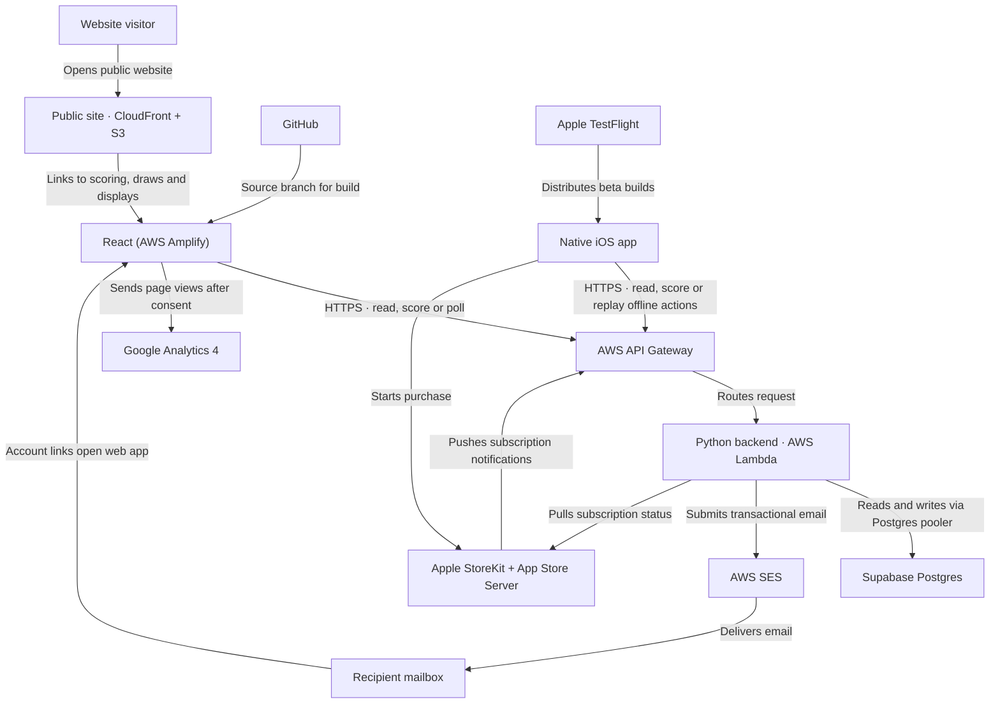
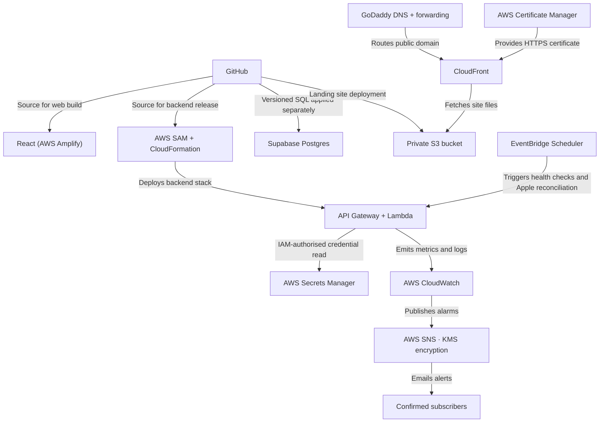
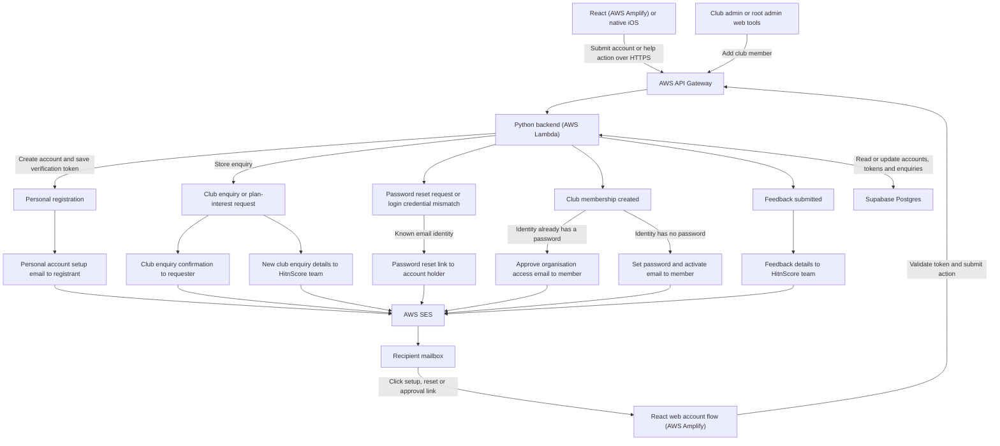
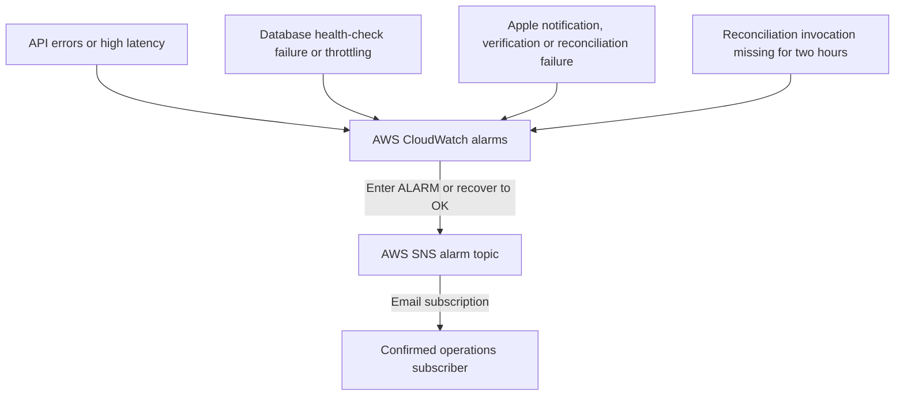

# HitnScore service relationships

**Naming:** HitnScore is the customer-facing application. `RcktScore` is the internal project and repository code name.

Current pre-launch architecture based on repository code, deployment templates and runbooks. Live provider settings were not checked. Arrows show who initiates the call or transfer.

## Application data flow

React runs in the browser after Amplify serves the app bundle. Web and iOS submit scoring actions through the same API. Spectator views pull updates through that API, and court displays poll every five seconds by default.

## Hosting, deployment and operations

## Email triggers and delivery

Checked against the current repository on 6 November 2026. These are implemented send paths; live delivery and provider configuration were not verified. Each email-type node below represents a separate message submitted to SES.

### What each email contains

| Trigger | Recipient | Email subject / purpose | Link or next action |
| --- | --- | --- | --- |
| Successful self-service Personal registration, including retry of a pending setup | Registrant | `Hit n Score personal account setup`: welcome, username and email verification/password setup | Choose password through the web confirmation flow; setup link expires after two hours. |
| Club enquiry, including an authenticated club plan-interest request | Requester | `Thanks for your Hit n Score club enquiry`: acknowledgement and supplied request details | Team will follow up; no automatic club activation. |
| Same club enquiry | Configured `INTEREST_TO_EMAIL` team mailbox | `New Hit n Score club account enquiry`: contact, club, requested plan, approval/validation status and diagnostic details | Reply-To is the requester; team can reply directly. |
| Password reset request for an existing identity | Account email | `Hit n Score password reset`: secure reset link | Choose a new password within two hours. Password changes apply across memberships and revoke active sessions. Unknown emails receive no message. |
| Login finds inconsistent membership passwords requiring an identity-wide reset | Account email | Same password reset email | Login returns `PASSWORD_RESET_REQUIRED`; user resets before signing in. A normal successful login sends no email. |
| Club admin or root admin creates membership for an identity with a password | Invited member | `Hit n Score: new organisation access for {organisation}`: club name, sign-in email and access confirmation | Approve access using the existing identity; invitation leaves membership pending until approval. |
| Club admin or root admin creates membership for an identity without a password | Invited member | `Hit n Score: welcome to {organisation}`: invitation and account activation | Set password and activate through a dedicated setup token. Invitation delivery requires a configured sender. |
| Valid feedback submission | Configured feedback/team mailbox | `RcktScore: {category}`: message, sender, organisation, version/build and page/device details | Reply-To is the submitter. No automatic acknowledgement email is sent to the submitter. |

Subjects above use the current templates, including the internal `RcktScore` name still present in the feedback subject. Transactional emails include HTML and plain-text versions. Sender and destination addresses are deployment-configured: `INTEREST_FROM_EMAIL`, `INTEREST_TO_EMAIL`, `PASSWORD_RESET_FROM_EMAIL`, `USER_INVITATION_FROM_EMAIL`, `FEEDBACK_FROM_EMAIL` and `FEEDBACK_TO_EMAIL`; feedback falls back to the interest configuration and then `hello@hitnscore.com` as implemented.

### Operational alert emails

Operational alerts use SNS rather than the app's SES templates. Creating the email subscription also requires the recipient to confirm the AWS subscription email. Alarm delivery depends on the production monitoring configuration and subscription confirmation.

Match creation, scoring, completion, scheduling, ordinary sign-in, password-reset completion, root-admin manual membership approval and persisted in-app notifications do not have additional automatic app email sends in the current code. Apple billing communications are managed by Apple; they are separate from these HitnScore email paths.

Email implementation references: [registration and enquiries](../backend/functions/register_interest/handler.py), [personal setup](../backend/common/root_admin_logic.py), [club invitations](../backend/common/organization_logic.py), [password resets](../backend/common/password_reset_logic.py), [login reset trigger](../backend/functions/login/handler.py), [feedback](../backend/functions/send_feedback/handler.py), [SES mailer](../backend/common/mailer.py), [email templates](../backend/notifications/templates/) and [SNS/CloudWatch configuration](../backend/template.yaml).

## Service inventory

| Component or supplier | Role in HitnScore | Who calls what and how data moves |
| --- | --- | --- |
| React/Vite web app · AWS Amplify Hosting | Serves the scoring app at `app.hitnscore.com`, including admin, public draws and spectator views. | Browser pulls the app bundle from Amplify. The loaded app calls API Gateway over HTTPS to fetch data or submit changes. `VITE_API_BASE_URL` supplies the API address at build time. |
| Apple iOS app · App Store Connect/TestFlight | Native scoring client and beta distribution. The Android/Compose foundation has no implemented product flows yet. | TestFlight distributes builds to testers. The installed iOS app calls the same HTTPS API as web. Offline scoring queues actions for one previously loaded match and replays them in order after reconnect. The backend deduplicates retries using action IDs. |
| AWS API Gateway HTTP API | Public HTTPS entry point for app requests, display reads and Apple callbacks. | Browser, iOS or Apple → API Gateway → route-specific Lambda → HTTP response. Protected routes enforce backend sessions and applicable membership, role or entitlement checks. |
| AWS Lambda · Python backend | Owns authentication, scoring rules, matches, accounts, tournaments, reporting and entitlements. | Reads and writes Supabase Postgres, sends email through SES, and verifies or reconciles Apple purchases. Returns results to the caller. |
| Supabase Postgres · connection pooler | Authoritative store for identities, sessions, clubs, courts, matches and events, notifications, subscriptions and audit data. | Lambda connects through the Postgres pooler and executes SQL. Web and iOS pull data through the API. In-app notification read state is shared through Postgres and fetched by clients. |
| AWS SES | Sends transactional email for account setup, password resets, club invitations and enquiries, and feedback. | Lambda → SES → recipient's mail provider. Account links open the web flow, which calls the API to complete the action. |
| AWS S3 and CloudFront | Host and deliver the separate public landing site at `www.hitnscore.com`. | Deployment script pushes `weblanding/` to private S3 and invalidates CloudFront. Browser pulls from CloudFront, which fetches files from S3 when needed. Links open the app for scoring, help, public draws or displays. |
| GoDaddy DNS and forwarding · AWS Certificate Manager | Connect the public domain to hosting and provide HTTPS for the landing site. | GoDaddy DNS resolves `www.hitnscore.com` to CloudFront. The documented GoDaddy forwarding sends the bare domain to `www`. CloudFront presents the ACM certificate, with domain validation through DNS. |
| Apple StoreKit and App Store Server services | Handle iOS Personal Plus purchases and subscription lifecycle. Purchase acceptance is deployment-gated. | iOS → StoreKit → signed purchase data → HitnScore API. Apple pushes signed lifecycle notifications to API Gateway. Reconciliation Lambda pulls subscription status from Apple's Server API and updates Postgres entitlements. Clients pull the resulting plan from HitnScore. |
| AWS Secrets Manager and IAM | Supply Apple API signing credentials when configured and grant service permissions. | Reconciliation Lambda reads the configured secret using its IAM role. Stack policies grant functions the AWS access they need, including SES sending. |
| AWS EventBridge Scheduler | Triggers backend checks without a client request. | Scheduler → health Lambda every five minutes → Postgres connectivity check. Scheduler → Apple reconciliation Lambda hourly when configured and enabled. |
| AWS CloudWatch, SNS and KMS | Monitor backend health and deliver operational alerts. | API Gateway and Lambda emit metrics and logs to CloudWatch. Alarms publish to an SNS topic encrypted with the AWS-managed KMS key. SNS emails confirmed subscribers. |
| Google Analytics 4 | Measures consented web usage. | The browser loads Google's tag after analytics consent. The React app sends sanitised page-view events to Google. |
| GitHub · AWS SAM and CloudFormation | GitHub holds source and change history. SAM and CloudFormation deploy the backend stack. | Developers push commits to GitHub. Amplify pulls the configured source branch to build the web app. The backend release process deploys the selected code through SAM/CloudFormation and applies versioned SQL to Supabase as a separate step. |

**Live score sync.** The scorer pushes a scoring action to the HTTP API. Lambda records it in Postgres. Spectator views pull updates over HTTPS. Court displays poll every five seconds by default. WebSocket broadcasting is scaffolded. Stripe checkout and Apple Push Notification service delivery are outside the current implementation.

Repository references: [backend stack](../backend/template.yaml), [web build](../amplify.yml), [landing deployment](weblanding-aws-godaddy-deployment.md), [request flows](technical-walkthrough.md), [scoreboard polling](scoreboard-v1-implementation.md), and [release process](promotion-runbook.md).

Backup ownership, recovery order, provider-specific restore steps, and recovery
validation are documented in the [Backup and recovery runbook](backup-and-recovery.md).
